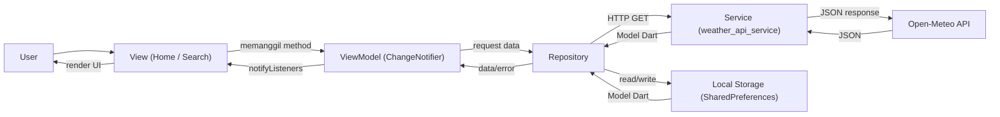

# DOKUMENTASI APLIKASI WEATHER APP

## 1. Struktur Aplikasi

### Pohon Folder

```
lib/
├── main.dart                                # Entry point aplikasi
├── core/                                    # Konfigurasi, widget reusable, & utilitas inti
│   ├── theme/
│   │   └── app_theme.dart                   # Theme, ColorScheme, TextTheme, WeatherPalette
│   ├── constants/
│   │   └── api_constants.dart               # URL API dan parameter
│   ├── utils/
│   │   └── weather_code_helper.dart         # Mapping WMO weather code + is_day
│   └── widgets/
│       ├── glass_card.dart                  # Komponen kartu kaca buram (glassmorphism)
│       ├── weather_background.dart          # Latar gradien dinamis + ambient blobs
│       └── weather_icon.dart                # Renderer SVG ikon cuaca Meteocons
├── models/                                  # Data class (MODEL di MVVM)
│   ├── location_model.dart                  # Model data lokasi/kota
│   ├── current_weather_model.dart           # Model cuaca terkini (+ isDay)
│   ├── hourly_forecast_model.dart           # Model forecast per jam (24 jam)
│   ├── daily_forecast_model.dart            # Model forecast harian (7 hari)
│   └── weather_response_model.dart          # Model gabungan response
├── services/                                # Akses jaringan (HTTP)
│   └── weather_api_service.dart             # Service HTTP GET ke Open-Meteo
├── repositories/                            # Penghubung data <-> logika
│   ├── weather_repository.dart              # Repository API cuaca
│   └── location_storage_repository.dart     # Repository local storage
├── viewmodels/                              # Logika bisnis (VIEWMODEL)
│   ├── weather_viewmodel.dart               # State Home Screen
│   └── search_viewmodel.dart                # State Search Screen + pratinjau favorit
└── views/                                   # Tampilan UI (VIEW)
    ├── home/
    │   ├── home_screen.dart                 # Halaman utama cuaca
    │   └── widgets/
    │       ├── current_weather_hero.dart    # Hero ikon & suhu besar
    │       ├── hourly_forecast_list.dart    # List horizontal kapsul per jam
    │       ├── weather_detail_grid.dart     # Grid 2 kolom detail cuaca
    │       ├── daily_forecast_card.dart     # Daftar forecast 7 hari + bar suhu
    │       ├── home_loading_skeleton.dart   # Skeleton shimmer loading
    │       └── home_error_view.dart         # Tampilan error & kosong
    └── search/
        ├── search_screen.dart               # Halaman pencarian kota
        └── widgets/
            ├── glass_search_bar.dart        # Input kapsul kaca
            ├── location_result_tile.dart    # Tile lokasi kaca
            ├── favorite_section.dart        # Daftar favorit
            ├── history_section.dart         # Daftar riwayat pencarian
            └── search_state_views.dart      # Loading skeleton, empty, error
```

### Fungsi Tiap Folder/File Penting

| Folder/File | Fungsi |
|---|---|
| `main.dart` | Titik masuk aplikasi. Mendaftarkan `MultiProvider` dan mengatur tema serta halaman awal. |
| `core/theme/` | Menyimpan konfigurasi tema Material 3, `ColorScheme`, `TextTheme` (Plus Jakarta Sans), dan `ThemeExtension<WeatherPalette>`. |
| `core/constants/` | Menyimpan URL API, parameter (`current`, `hourly`, `daily`), dan lokasi default. |
| `core/utils/` | Utilitas mapping WMO `weather_code` ke deskripsi bahasa Indonesia, path aset SVG siang/malam, dan `WeatherMood`. |
| `core/widgets/` | Widget UI reusable (`GlassCard`, `WeatherBackground`, `WeatherIcon`) agar konsisten di semua screen. |
| `models/` | Data class murni. Berisi `fromJson`/`toJson` untuk konversi JSON. |
| `services/` | Menangani HTTP GET request ke API Open-Meteo dengan timeout dan error handling. |
| `repositories/` | Jembatan antara service/storage dan viewmodel. |
| `viewmodels/` | Menyimpan state (`ViewState`/`SearchState`) dan logika bisnis, memanggil `notifyListeners()`. |
| `views/` | Widget UI murni yang menampilkan data dari ViewModel tanpa logika bisnis/HTTP. |

---

## 2. Implementasi API

### 2.1 Geocoding API (Pencarian Kota)

**Endpoint:**
```
GET https://geocoding-api.open-meteo.com/v1/search
```

**Parameter:**
| Parameter | Nilai | Keterangan |
|---|---|---|
| `name` | `{input user}` | Nama kota yang dicari |
| `count` | `10` | Maksimal 10 hasil |
| `language` | `id` | Bahasa Indonesia |
| `format` | `json` | Format respons JSON |

Jika key `results` tidak ada di respons, dianggap hasil kosong (`[]`).

### 2.2 Weather Forecast API (Data Cuaca)

**Endpoint:**
```
GET https://api.open-meteo.com/v1/forecast
```

**Parameter:**
| Parameter | Nilai | Keterangan |
|---|---|---|
| `latitude` | `{dari geocoding}` | Koordinat lintang |
| `longitude` | `{dari geocoding}` | Koordinat bujur |
| `current` | `temperature_2m,relative_humidity_2m,apparent_temperature,is_day,precipitation,weather_code,wind_speed_10m` | Data cuaca terkini & status siang/malam |
| `hourly` | `temperature_2m,weather_code,precipitation_probability` | Perkiraan per jam (diambil 24 jam ke depan) |
| `daily` | `weather_code,temperature_2m_max,temperature_2m_min,precipitation_probability_max` | Data forecast harian |
| `timezone` | `auto` | Zona waktu otomatis |
| `forecast_days` | `7` | 7 hari ke depan |

### 2.3 Penanganan Loading, Kosong, dan Error

Aplikasi menggunakan enum `ViewState` / `SearchState` (`initial`, `loading`, `success`, `empty`, `error`):
- **Loading:** Menampilkan skeleton/shimmer bergaya kaca buatan sendiri dengan `AnimationController`.
- **Success:** Menampilkan data cuaca terkini, per jam, detail 2 kolom, dan harian.
- **Empty:** Menampilkan `GlassCard` dengan ikon SVG dan pesan panduan (mis. "Kota tidak ditemukan").
- **Error:** Menampilkan `GlassCard` dengan pesan error ramah pengguna dan tombol **Coba Lagi**.

---

## 3. Penerapan MVVM

Arsitektur MVVM dipertahankan secara ketat:
- **View** (`views/**`) hanya membaca state dari ViewModel (`Consumer`/`select`) dan memanggil method ViewModel. Tidak ada request HTTP atau akses `SharedPreferences` di View.
- **ViewModel** (`viewmodels/**`) mengolah data dari Repository dan memanggil `notifyListeners()`, tanpa mengimpor widget atau `BuildContext`.
- **Repository** (`repositories/**`) menjadi perantara antara `WeatherApiService` / `LocationStorageRepository` dengan ViewModel.
- **Model** (`models/**`) hanya menampung data dan konversi JSON.



---

## 4. Desain UI

### 4.1 Konsep Glassmorphism
Antarmuka aplikasi menggunakan konsep **kaca transparan berwarna (*frosted glassmorphism*)** di atas latar gradien dinamis. Semua nilai gaya (warna tint, opacity, sigma blur, radius sudut, border, dan warna teks) dikelola terpusat melalui `ThemeExtension<WeatherPalette>` di `app_theme.dart` serta tipografi **Plus Jakarta Sans** (`TextTheme`).

### 4.2 Pembagian Widget Reusable (`core/widgets/`)
1. **`GlassCard` (`core/widgets/glass_card.dart`)**
   Membungkus konten dengan `ClipRRect` + `BackdropFilter(ImageFilter.blur)`, isi berupa gradien transparan bertint warna, border tipis 1 px semi-transparan, serta bayangan lembut. Untuk daftar yang bisa di-scroll (seperti list per jam dan hasil pencarian), blur diatur lebih ringan dan dibungkus `RepaintBoundary` agar performa scroll tetap mulus.
2. **`WeatherBackground` (`core/widgets/weather_background.dart`)**
   Menyediakan latar belakang gradien penuh yang berubah halus dalam 600 ms (`AnimatedContainer`) sesuai cuaca dan siang/malam, ditambah 3 lingkaran gradien radial lembut (*ambient blobs*) di belakang konten untuk memberi kedalaman di balik kaca.
3. **`WeatherIcon` (`core/widgets/weather_icon.dart`)**
   Merender aset ikon vektor SVG **Meteocons** menggunakan `flutter_svg` berdasarkan kode cuaca (`weatherCode`) dan waktu (`isDay`).

### 4.3 Pemilihan Ikon & Latar Berdasarkan `weather_code` dan `is_day`
`WeatherCodeHelper` (`core/utils/weather_code_helper.dart`) memetakan WMO `weather_code` dan boolean `is_day` menjadi tiga hal:
- **Deskripsi bahasa Indonesia** (misal kode `0` -> "Cerah", `61` -> "Hujan Ringan").
- **Path aset SVG Meteocons** dengan varian siang/malam (misal kode `0`: `clear-day.svg` saat `isDay == true`, `clear-night.svg` saat `isDay == false`).
- **Suasana latar (`WeatherMood`)**: `clearDay` (biru langit ke teal), `cloudy` (abu kebiruan), `rain` (teal gelap ke biru laut), `storm` (biru tua keunguan gelap), `night` (navy ke indigo), dan `fog` (abu kehijauan pudar).
