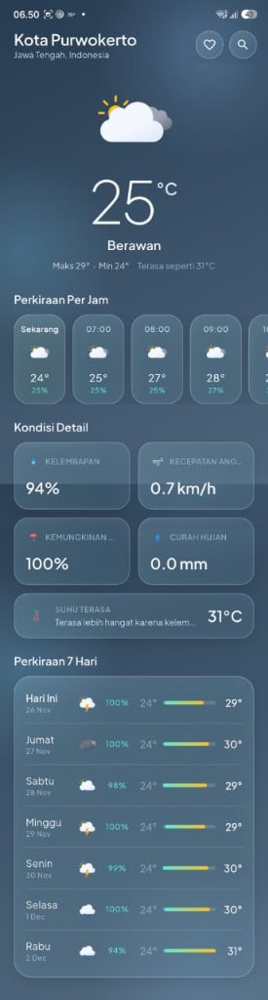
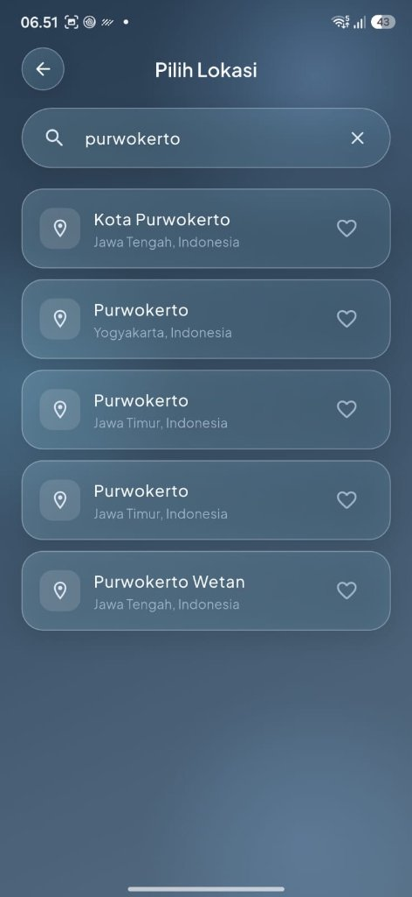
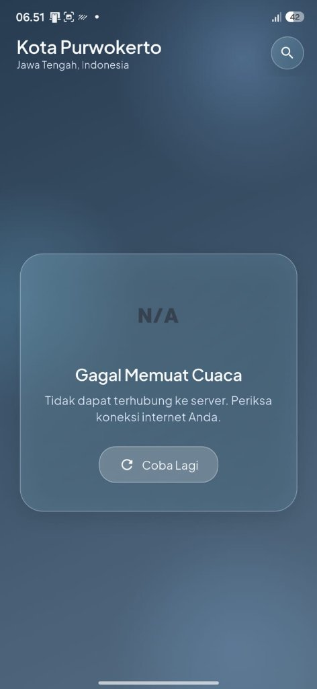

# Weather App (Responsi Flutter)

Aplikasi cuaca berbasis Flutter yang menampilkan data cuaca real-time dari API Open-Meteo dengan tampilan modern dan latar gradien dinamis sesuai kondisi cuaca serta siang/malam.

> **Nama:** Nayli Ghassaniy Latifatun Nida 
> **NIM:** H1D024058  
> **Shift Awal:** Shift E
> **Shift Akhir:** Shift D  

## Fitur Utama

- **Cuaca Terkini** — Suhu, deskripsi kondisi, kelembapan, kecepatan angin, kemungkinan hujan, curah hujan, dan suhu yang dirasakan
- **Latar Dinamis Siang/Malam** — Gradien latar dan aksen berubah halus mengikuti kondisi cuaca dan status siang/malam (`is_day`)
- **Perkiraan Per Jam (24 Jam)** — Daftar kapsul kaca horizontal untuk memantau suhu dan peluang hujan tiap jam
- **Perkiraan 7 Hari** — Forecast harian lengkap dengan suhu min/max, bar rentang suhu proporsional, ikon cuaca, dan peluang hujan
- **Pencarian Kota** — Pencarian kota seluruh dunia melalui Open-Meteo Geocoding API (dengan debounce 500 ms)
- **Lokasi Favorit & Riwayat** — Simpan kota favorit (lengkap dengan pratinjau suhu mini) dan riwayat pencarian di *local storage*
- **Pull-to-Refresh & Penanganan State** — Skeleton loading, empty state, dan error state bergaya kaca

## Teknologi

| Teknologi | Keterangan |
|---|---|
| **Flutter** | Framework UI cross-platform (Material 3) |
| **Dart** | Bahasa pemrograman |
| **Provider** | State management (`ChangeNotifier`) |
| **http** | HTTP client untuk REST API |
| **shared_preferences** | Local storage (favorit, riwayat, lokasi terakhir) |
| **flutter_svg** | Render aset ikon cuaca vektor SVG |
| **google_fonts** | Tipografi Plus Jakarta Sans |
| **intl** | Format tanggal dan jam |
| **Open-Meteo API** | Sumber data cuaca (gratis, tanpa API key) |

## Arsitektur

Aplikasi menggunakan arsitektur **MVVM (Model-View-ViewModel)**:

```
lib/
├── main.dart                               # Entry point + MultiProvider setup
├── core/
│   ├── theme/app_theme.dart                # Theme, ColorScheme, TextTheme, WeatherPalette
│   ├── constants/api_constants.dart        # URL & parameter API Open-Meteo
│   ├── utils/weather_code_helper.dart      # Mapping weather_code + is_day -> ikon & suasana
│   └── widgets/
│       ├── glass_card.dart                 # Kartu kaca buram reusable (BackdropFilter)
│       ├── weather_background.dart         # Latar gradien dinamis + ambient blobs
│       └── weather_icon.dart               # Renderer ikon cuaca SVG Meteocons
├── models/                                 # MODEL — data classes
│   ├── location_model.dart
│   ├── current_weather_model.dart
│   ├── hourly_forecast_model.dart
│   ├── daily_forecast_model.dart
│   └── weather_response_model.dart
├── services/                               # HTTP GET ke API Open-Meteo
│   └── weather_api_service.dart
├── repositories/                           # Penghubung service/storage <-> viewmodel
│   ├── weather_repository.dart
│   └── location_storage_repository.dart
├── viewmodels/                             # VIEWMODEL — state & logika bisnis
│   ├── weather_viewmodel.dart
│   └── search_viewmodel.dart
└── views/                                  # VIEW — tampilan UI
    ├── home/
    │   ├── home_screen.dart
    │   └── widgets/
    │       ├── current_weather_hero.dart
    │       ├── hourly_forecast_list.dart
    │       ├── weather_detail_grid.dart
    │       ├── daily_forecast_card.dart
    │       ├── home_loading_skeleton.dart
    │       └── home_error_view.dart
    └── search/
        ├── search_screen.dart
        └── widgets/
            ├── glass_search_bar.dart
            ├── location_result_tile.dart
            ├── favorite_section.dart
            ├── history_section.dart
            └── search_state_views.dart
```

## Cara Menjalankan

1. Pastikan Flutter SDK sudah terinstal (versi stabil)
2. Clone repository ini
3. Install dependencies:
   ```bash
   flutter pub get
   ```
4. Jalankan aplikasi:
   ```bash
   flutter run
   ```

## Screenshot

| Home Screen | Search Screen |
| :---: | :---: |
|  |  |

| Empty State | Error State |
| :---: | :---: |
|  |  |

## API yang Digunakan

### Geocoding API (Pencarian Kota)
```
GET https://geocoding-api.open-meteo.com/v1/search?name={kota}&count=10&language=id&format=json
```

### Weather Forecast API (Data Cuaca)
```
GET https://api.open-meteo.com/v1/forecast?latitude={lat}&longitude={lon}&current=temperature_2m,relative_humidity_2m,apparent_temperature,is_day,precipitation,weather_code,wind_speed_10m&hourly=temperature_2m,weather_code,precipitation_probability&daily=weather_code,temperature_2m_max,temperature_2m_min,precipitation_probability_max&timezone=auto&forecast_days=7
```

Dokumentasi resmi:
- [Weather Forecast API](https://open-meteo.com/en/docs)
- [Geocoding API](https://open-meteo.com/en/docs/geocoding-api)

## Credits

- **Ikon Cuaca:** [Meteocons](https://github.com/basmilius/weather-icons) oleh **Bas Milius** (Lisensi MIT) — varian SVG `fill` statis
- **Tipografi:** **Plus Jakarta Sans** melalui package `google_fonts`

